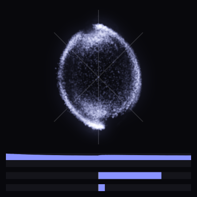
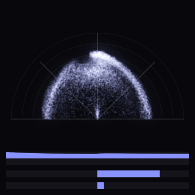
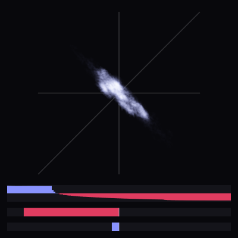

# NEMURA Stereometer

A free, open-source stereometer for Apple Silicon Macs: a goniometer/vectorscope with correlation
and balance meters, drawn with Metal at your display's refresh rate.

<p align="center">
  
  
  
</p>

It comes in two parts that work alone or together:

- **NEMURA Stereometer.app**: a floating, borderless meter window, fully transparent by default.
  It shows everything your Mac plays (no audio driver to install) or one plugin instance in your
  DAW.
- **NEMURA Stereometer plugin** (CLAP, VST3, Audio Unit): an insert with zero latency that passes
  audio through untouched. It shows the meter inside the DAW, sends its audio to the app, or both.

## Features

- **Six display modes:** Goniometer, Goniometer (Log), Half goniometer, Half goniometer (Log),
  Lissajous, and NEMURA, an original glowing look.
- **Views:** M/S (mono vertical) or L/R orientation; dots or lines; guides off, subtle or full.
- **Meters:** correlation (−1 to +1) with a short history strip, and L/R balance, each with an
  optional readout and a selectable integration time (50 ms to 3 s).
- **Points and lines:** size, shape (soft, circle, square), line thickness, density
  (interpolated points), brightness and glow.
- **Response:** trail time from 5 ms to 2 s, with Instant, Fast, Medium, Slow and Very slow presets.
- **Level:** gain from −24 to +36 dB, and auto-gain (off, slow, fast).
- **Color:** by frequency, solid, amplitude or mid/side. Six original colormaps (Iris, Chrome,
  Bloodmoon, Phosphor, Aurora, Glacier), and you can import your own MiniMeters `.map` files.
- **Window (app):**
  - background color and opacity, from fully transparent to solid
  - always on top, on every Space and over full-screen apps
  - click-through (⌃⌥⌘S) and show/hide (⌃⌥⌘H) from anywhere
  - size presets or free resize, and an optional Dock icon
- **Presets:** Mix, Stage, NEMURA and Classic, plus your own. The app and the plugin share one
  preset format; the app imports and exports them.
- **Performance:** frame rate Auto (follows the display), 120, 60 or 30.

## Requirements

- macOS 14.2 (Sonoma) or later.
- The app runs on Apple Silicon. The plugins are Universal, so they also load on Intel Macs and in
  hosts running under Rosetta.

## Install

Download from the [latest release](https://github.com/nemura0/nemura-stereometer/releases/latest):

| File | What it installs |
|---|---|
| `NEMURA-Stereometer-<version>.dmg` | The app: open it and drag **NEMURA Stereometer** to Applications. |
| `NEMURA-Stereometer-Plugins-<version>.pkg` | The plugins. Choose CLAP, VST3 and/or Audio Unit, for all users (`/Library/Audio/Plug-Ins`) or only you (`~/Library/Audio/Plug-Ins`). |

`SHA256SUMS` on the release page lets you check the downloads (`shasum -a 256 -c SHA256SUMS`).

Or with [Homebrew](https://brew.sh):

```bash
brew install --cask nemura0/tap/stereometer          # the app
brew install --cask nemura0/tap/stereometer-plugins  # CLAP, VST3 and AU
```

### Opening an app that Apple has not notarized

NEMURA Stereometer is signed, but not notarized by Apple (notarization requires a paid Apple
Developer account). The first time you open the app or the installer, macOS blocks it. To allow it:

1. Try to open it once, and close the warning.
2. Open **System Settings › Privacy & Security**, scroll down, and click **Open Anyway** next to
   the message about NEMURA Stereometer. Confirm with your password.

Or, for the app, remove the quarantine flag in Terminal:

```bash
xattr -dr com.apple.quarantine "/Applications/NEMURA Stereometer.app"
```

You need to do this once per download. The Homebrew casks print the same steps.

## Audio capture and privacy

To meter everything your Mac plays, the app uses a Core Audio process tap. macOS asks once for
permission to capture system audio; the first-run sheet explains it before the prompt appears.

- The audio is analyzed on your Mac, in memory, and drawn. It is **never recorded, saved or sent
  anywhere**. The app makes no network connections.
- If you denied the permission, macOS delivers silence rather than an error. The app notices and
  shows how to turn it on: **System Settings › Privacy & Security › Screen & System Audio
  Recording**, then enable NEMURA Stereometer under **System Audio Recording Only**.
- Metering a plugin instance needs no permission: the plugin shares its audio with the app through
  memory on your Mac only.

## Using the app

- Click the menu bar icon for the source picker (**System Output** or a plugin instance), the
  display mode, the preset, opacity and click-through.
- **Settings…** (⌘,) holds every option, grouped in a sidebar. Changes show live on the meter.
- Right-click the meter for the same quick items. Hover over it to show the close, minimize and
  settings buttons.
- With click-through on, the meter ignores the mouse so you can work under it. ⌃⌥⌘S turns it
  off again from anywhere.

## Using the plugin

Insert NEMURA Stereometer on any stereo track, bus or the master. It adds no latency, and its
output is bit-identical to its input, so it is safe anywhere in a chain.

The editor's top bar has **Send to app**, the display mode, the preset and the response. The gear
opens the rest of the settings. The dot next to Send to app shows its state: green when the app
is receiving, amber when the app isn't running, red when this host doesn't allow it, grey when
off. To watch a track in the floating meter, turn on Send to app and pick that instance in the
app's source picker. Instances are listed as "Stereometer 1", "Stereometer 2", and so on.

The plugin's settings are saved with your project. It has no automatable parameters.

| Host | Format | Where to find it |
|---|---|---|
| Ableton Live 12 | VST3 or AU | Browser › Plug-Ins (turn on *Use VST3 Plug-In System Folders* or *Use Audio Units* in Settings › Plug-Ins) |
| FL Studio | CLAP, VST3 or AU | Plugin Manager › Find plugins, then the Mixer's effect slots |
| Logic Pro, GarageBand | AU | Audio FX › Audio Units › NEMURA |
| Bitwig Studio, REAPER | CLAP (or VST3) | the plugin browser, under NEMURA |
| Cubase, Studio One | VST3 | the plugin browser, under NEMURA |

Ableton Live 12 and FL Studio have been tested by hand. Logic and GarageBand can run Audio Units
in a separate process; Send to app works there too, and the automated tests cover that case.

If a host doesn't list the plugin after installing, rescan its plugins. For Audio Units, macOS
caches the list: the installer refreshes it, or run `killall -9 AudioComponentRegistrar`.

## Building from source

Requirements: Xcode 26 or later, CMake 3.28+ and Ninja (`brew install cmake ninja`).

```bash
scripts/build.sh                # fetch the pinned SDKs, build the plugins, tests and app, sign
scripts/build.sh test           # C++ and Swift tests
scripts/install-plugins.sh      # copy the plugins to ~/Library/Audio/Plug-Ins
scripts/validate.sh             # auval, pluginval and clap-validator, both architectures
scripts/package.sh              # build/dist: the .dmg, the .pkg and SHA256SUMS
```

Builds are signed ad-hoc unless you create a local signing identity first
(`scripts/make-signing-identity.sh`, see [docs/SIGNING.md](docs/SIGNING.md)). With ad-hoc
signing, macOS asks for the audio-capture permission again after every rebuild.

`scripts/rename.sh --name "..."` renames the product in one step; names and identifiers live in
[config/product.env](config/product.env). The design notes are in [docs/](docs/), and
[CLAUDE.md](CLAUDE.md) lists the commands and the rules the code follows.

## License and credits

MIT, see [LICENSE](LICENSE). NEMURA Stereometer is built on CLAP and clap-wrapper, the VST 3 SDK,
Apple's AudioUnitSDK, nlohmann/json and doctest; see
[THIRD_PARTY_NOTICES.md](THIRD_PARTY_NOTICES.md) for versions and licenses.

VST is a registered trademark of Steinberg Media Technologies GmbH. Audio Units is a trademark of
Apple Inc. This project is not affiliated with MiniMeters; it only reads `.map` files you supply.
